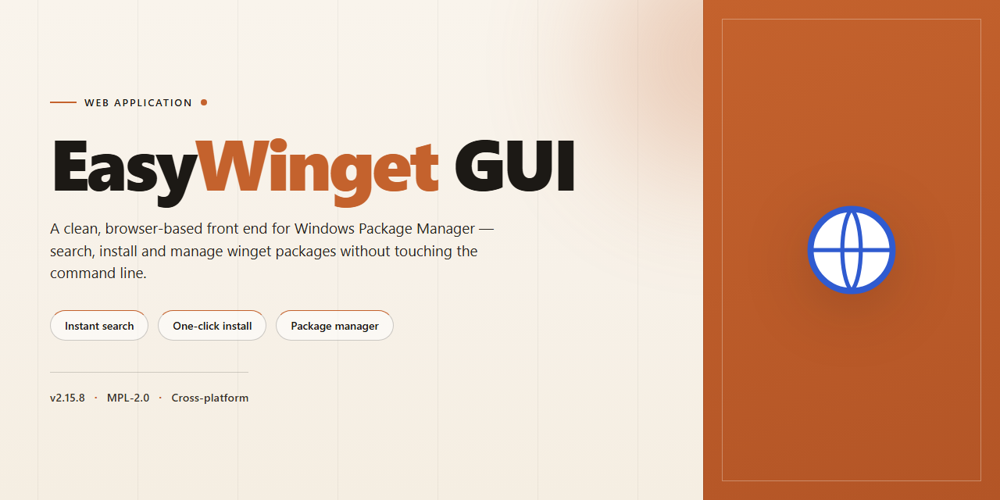

# EasyWinget GUI — Modern Software Management Web Application 🚀

### 📦 PowerShell Install Button

   

---

EasyWinget GUI turns the Windows Package Manager into a fast, elegant web interface for installing, updating, and managing software without touching the command line. Built with Node.js and Vanilla JS, it pairs lightweight performance with a clean, modern design that keeps every package action a click away. Search, install, and track updates from a single streamlined dashboard that feels right at home on Windows.

## ✅ Requirements

- Windows 10 or Windows 11
- PowerShell 5.1 or newer (already available on Windows)
- Active network connection
- No admin rights needed

## Features

* **⚡ Effortless Package Management:** Browse, search, and install from the full Winget catalog without ever touching a terminal. Everything is a click away.
* **📦 One-Click Installs & Updates:** Deploy new software or keep existing apps current with a single action, backed by clear progress feedback at every step.
* **🔄 Centralized Update Center:** See every outdated package in one place, complete with version comparisons, so you can update individually or all at once.
* **🗂️ Installed Software at a Glance:** A clean, unified view of everything on your machine, with quick actions to upgrade, remove, or inspect any entry.
* **🔍 Smart Search & Discovery:** Instant, responsive filtering surfaces the right package fast — no more guessing exact manifest names.
* **🪶 Lightweight by Design:** A snappy Node.js backend and vanilla JavaScript frontend keep the experience fast and the footprint small.
* **🎨 Modern, Polished Interface:** A refined, distraction-free layout that makes managing software feel genuinely pleasant.
* **🖥️ Runs Locally, Stays Private:** The GUI operates on your own machine and drives the native Windows Package Manager directly — no accounts, no cloud round-trips.
* **🧩 Zero Friction Setup:** Built to feel intuitive from the very first launch, so beginners and power users alike can get productive immediately.

## Tech Stack

EasyWinget GUI is built on a deliberately lean, modern foundation — every layer chosen to keep the experience fast, dependable, and effortless to run on any Windows machine.

**Node.js Runtime**
A lightweight Node.js backend powers the application's core: orchestrating Windows Package Manager operations, managing package catalogs, and streaming live status back to the interface. It handles the heavy lifting quietly in the background so the front end stays instant and responsive.

**Vanilla JavaScript Front End**
No frameworks, no bloat. The interface is crafted in clean, dependency-free vanilla JavaScript — delivering a snappy, native-feeling web GUI that loads in a blink and stays out of your way while you install, update, and manage software.

**Windows Package Manager Integration**
EasyWinget GUI speaks directly to the native Winget CLI, turning its command-line power into an approachable visual workflow. Search, install, upgrade, and remove packages through a polished interface backed by the same trusted engine powering modern Windows software management.

**Zero-Dependency Philosophy**
By pairing a minimal Node.js backend with framework-free front-end code, EasyWinget GUI keeps its footprint small and its behavior transparent. The result is a product that feels refined and marketing-ready on the surface — and refreshingly simple underneath.

## Security & Privacy

**Open Source & Transparent**: The entire codebase is open-source under the MIT license. There is no telemetry, no analytics, and no hidden tracking — what you see in the repository is exactly what runs on your machine.
- **Native Execution**: Every install, update, and uninstall operation is executed directly against the local Microsoft Windows Package Manager CLI. EasyWinget GUI acts purely as a friendly interface layer — it never proxies your data through external servers or third-party services.
- **Isolated Local Persistence**: Application data stays on your device. In Installed Mode, everything is scoped to `%LOCALAPPDATA%\EasyWinget-GUI\`, while Portable Mode keeps all files strictly within the application folder — zero registry trace, no leftover pollution.
- **Cryptographic Verification**: Every release ships with SHA-256 checksums so you can verify binary integrity before running the tool, and confirm that what you downloaded matches what the project published.
- **Minimal Permissions by Design**: EasyWinget GUI requests only the elevation it needs to perform package operations through Winget, and never escalates privileges behind the scenes or in the background.

## FAQ

**Is EasyWinget GUI a replacement for the command line?**
Not at all — it is a polished layer on top of it. EasyWinget GUI talks directly to the Windows Package Manager already present on your system, so every install, upgrade, and removal you trigger from the interface is the same trusted operation you would otherwise type out by hand. Think of it as the cockpit, not a new engine.

**Do I need to know anything about package managers to get started?**
No prior experience required. Search for the software you want, pick it from the catalog, and press install. The interface handles the rest, surfacing progress, version details, and results in plain language while the underlying work happens quietly in the background.

**Which Windows versions are supported?**
EasyWinget GUI is built for modern Windows environments where the Windows Package Manager is available. If your system can run Winget, it can run EasyWinget GUI — no additional runtime or toolchain is needed on your machine.

**How is this different from other software installers?**
Most installers bundle toolbars, upsells, and background services. EasyWinget GUI pulls packages from the official Windows Package Manager catalog, so what you see is what you get — clean, signed, and maintained by the original publishers. Updates are handled the same way: detected, listed, and applied on your terms.

**Can I manage updates without babysitting them?**
Yes. The updates view surfaces everything with a newer version available, shows you the exact version jump, and lets you apply changes one at a time or in a single sweep. Prefer to hold a specific package back? Mark it as ignored and it stays exactly where you want it.

**Where does my data live?**
Locally, and only locally. EasyWinget GUI keeps its records on your own machine and does not ship telemetry, analytics, or usage pings anywhere. Your installed-software inventory, preferences, and history stay under your control.

**Is it safe to use?**
Every action maps to a standard Windows Package Manager operation executed against the official catalog, and the project is fully open source so you can inspect exactly what runs under the hood. No hidden network calls, no third-party bundling, no surprises.

**Do I need Node.js installed to use it?**
No. Node.js is part of the project's build stack for contributors, not a requirement for everyday use. Once running, EasyWinget GUI is a self-contained experience — open it, browse, install, done.

**Can I use it on a machine I don't administer?**
Absolutely. Because it relies on the package manager already present on the system, it works cleanly in environments where you have standard user permissions. Administrative elevation is only requested when a specific package genuinely calls for it.

**What if a package isn't in the catalog?**
The catalog is vast and growing, covering development tools, browsers, media apps, utilities, and more. If something you need isn't listed yet, it likely will be soon — the index is community-maintained and refreshed continuously.

**Is EasyWinget GUI free?**
Yes — completely. It is open source and free to use, modify, and share. No accounts, no license keys, no premium tier. Just a faster, friendlier way to manage the software on your Windows machine.

## License

EasyWinget GUI is released under the MIT License, giving you the freedom to use, modify, and distribute the software with confidence. Whether you're deploying it across a, adapting it to your workflow, or simply running it on your own machine, the permissive terms are designed to stay out of your way.

The license grants permission, free of charge, to any person obtaining a copy of this software and associated documentation files, to deal in the software without restriction — including the rights to use, copy, modify, merge, publish, distribute, sublicense, and sell copies of the software — subject to the inclusion of the copyright notice and this permission notice in all copies or substantial portions of the software.

The software is provided "as is", without warranty of any kind, express or implied, including but not limited to the warranties of merchantability, fitness for a particular purpose, and noninfringement. In no event shall the authors or copyright holders be liable for any claim, damages, or other liability, whether in an action of contract, tort, or otherwise, arising from, out of, or in connection with the software or the use or other dealings in the software.

For the complete legal text, refer to the LICENSE file distributed with the project.